<p align="center">
  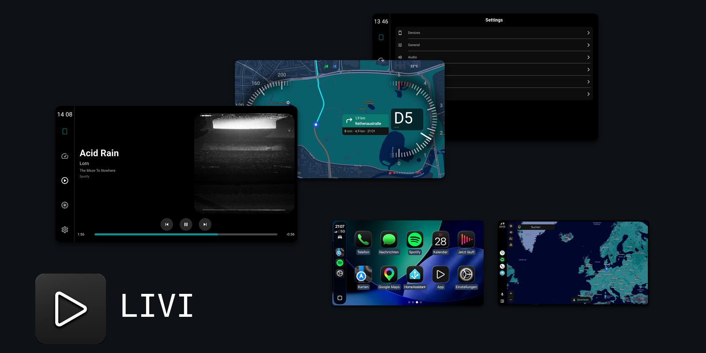
</p>

# LIVI – Linux In-Vehicle Infotainment

LIVI is an open-source **Apple CarPlay and Android Auto head unit**.

It is a standalone cross-platform head unit with a native, zero-copy GStreamer video pipeline and hardware-accelerated decoding across Linux (from x86_64 and arm64 desktops to embedded boards like the Raspberry Pi) and macOS, with low-latency audio, multitouch + D-Pad navigation, and support for very small embedded/OEM displays.

## Project Status


<a href="https://discord.gg/cv6Gd8wDKB"></a>

## Native Connectivity

- **Apple CarPlay** (wired & wireless) on Linux and Mac, requires [MFi Authentication](#mfi-authentication)
- **Android Auto** (wired & wireless) on Linux and Mac, wireless on Mac requires a [LIVI Link](LIVI-LINK.md)

## Native Apple CarPlay Ultra

LIVI implements the CarPlay accessory side natively, wired and wireless, on Linux and on macOS. Wireless sessions run over LIVI's own Wi-Fi access point with Bluetooth pairing, wired sessions run directly over the USB cable (no OTG required).

- main and instrument cluster video (H.264 and H.265/HEVC, hardware decoded, zero-copy)
- configurable cluster content: map or maneuver card, compass, ETA, speed limit
- audio playback, phone calls, microphone uplink, Siri
- volume in both directions between phone and LIVI
- now-playing metadata incl. album art, turn-by-turn navigation data
- touch, knob/d-pad and hard-key input
- GPS forwarding and clock synchronization
- day/night mode
- dock position left, right or bottom, right-hand drive
- multi-session with live switching between connected phones
- wireless sessions move to the cable when plugged in
- video in the car (AirPlay video while parked, no FairPlay-protected content)
- climate control in the CarPlay dock
- Radio, Climate and Car apps\*
- extended vehicle data\*
- car maker themes\*

\* CarPlay Ultra only

Wireless CarPlay requires a Bluetooth and a Wi-Fi interface. Both can come from a [LIVI Link](LIVI-LINK.md), which brings its own radios. Wired CarPlay works on any USB port.

## MFi Authentication

CarPlay requires the accessory to authenticate against the phone. The usual way is an Apple **MFi authentication coprocessor**, a hardware chip that cannot be emulated and that LIVI neither ships nor bypasses. Two routes:

- **On the board**: a coprocessor wired to the I²C bus
- **Over the network**: a [LIVI Link](LIVI-LINK.md)

Both routes work on Linux. A Mac has no I²C bus to put a coprocessor on, so there the LIVI Link is the only one.

LIVI does not support Apple's Basic Accessory Authentication on MacOS, but may in the future.

For a chip on the board, configuration (`config.json`):

| Key                   | Default | Description                          |
| --------------------- | ------- | ------------------------------------ |
| `carPlayMfiI2cBus`    | `2`     | I²C bus number the coprocessor is on |
| `carPlayMfiPowerGpio` | `21`    | GPIO that powers the coprocessor     |

Without one of these, native CarPlay is unavailable. All Android Auto paths work regardless.

## Wireless

Wireless sessions do not need a router. LIVI brings up its own Wi-Fi access point and the phone joins that. Bluetooth carries the pairing and the handover, the session itself then runs over Wi-Fi.

Wireless CarPlay and wireless Android Auto are enabled separately, so a head unit can offer one, both, or neither. With Auto Connect on, a phone that has been paired before is picked up again on its own. The car name is what the phone shows when it lists nearby vehicles.

The Wi-Fi page sets the band, password, channel and country for the access point and picks the Wi-Fi interface. The Bluetooth adapter is picked next to it, under Connections.

Dedicated Interface reserves the Wi-Fi adapter for the access point and brings it up during boot, out of NetworkManager's hands. Without it the access point is started on demand and the interface is handed back afterwards, which keeps it available for normal networking but costs a moment on the first connection.

Configure under Settings → General → Connections.

<p align="center">
  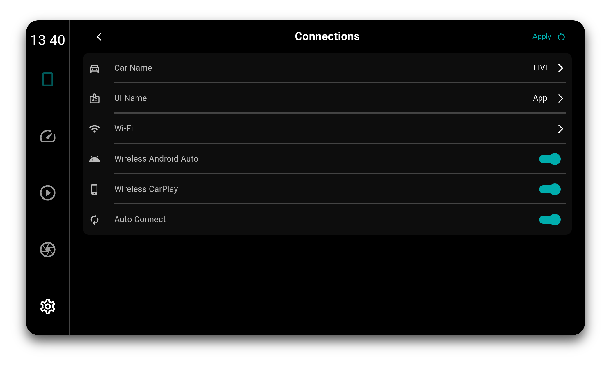
  &emsp;
  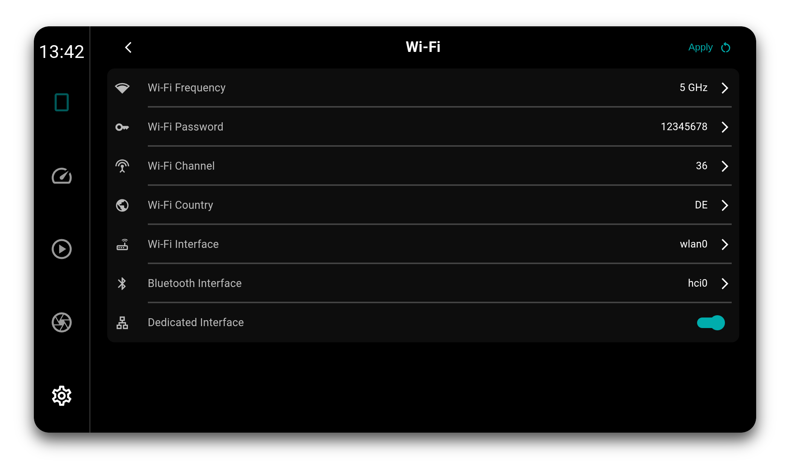
</p>

## Multi-Session

Several phones can be connected at the same time. All of them are tracked live: every session keeps its state, its battery and signal readings, its media metadata and its turn-by-turn navigation up to date in the background, not just the one on screen.

Switching is a handover, not a reconnect. The drivers stay armed and the video and audio paths stay open, so bringing another phone forward takes milliseconds instead of multiple seconds.

Wireless CarPlay, wired CarPlay and wireless Android Auto each take several devices at once. Wired Android Auto is currently limited to one device. Everything within that limit can be combined freely, so a mixed set of CarPlay and Android Auto phones over cable and Wi-Fi is a normal case, not an exception.

Each device is shown with its transport, its battery level and its carrier or signal strength, and the numbered badge is the slot it occupies. The active session is highlighted, the others are marked as available.

Switch from the device list, or bind a key under Settings → General → Key Bindings → Cycle Session to step through the connected phones. Removing a device ends its session and forgets the pairing.

Manage under Settings → Devices.

<p align="center">
  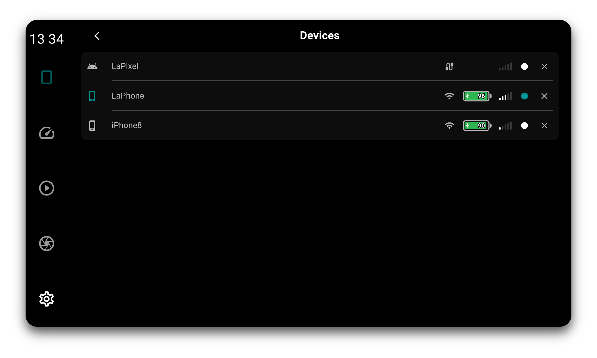
</p>

## Display Calibration

Car displays are rarely colour accurate. Cheap panels wash out blacks, run cold or warm, or crush the shadows once the sun hits them. LIVI can correct this in software.

Gamma, contrast, and the red, green and blue channels are adjustable independently. The correction is applied by the compositor as a single pass over the finished frame, so it covers everything on screen: the LIVI interface, the dashboards, and the projected CarPlay or Android Auto video alike.

The pass only runs while a value differs from its default, so a display that needs no correction costs nothing.

Configure under Settings → Appearance → Contrast / Gamma and Settings → Appearance → Color.

<p align="center">
  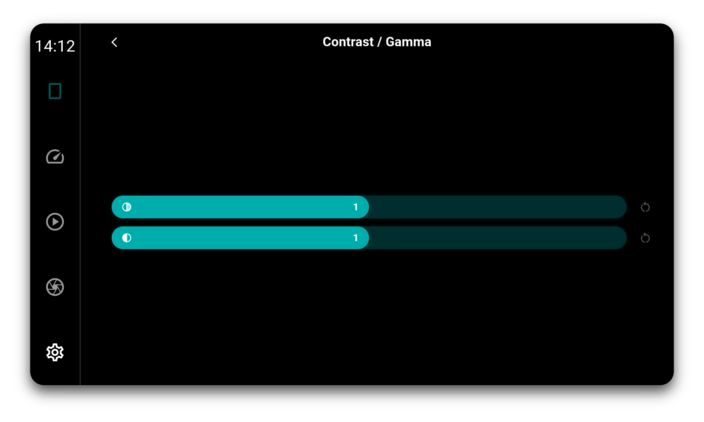
  &emsp;
  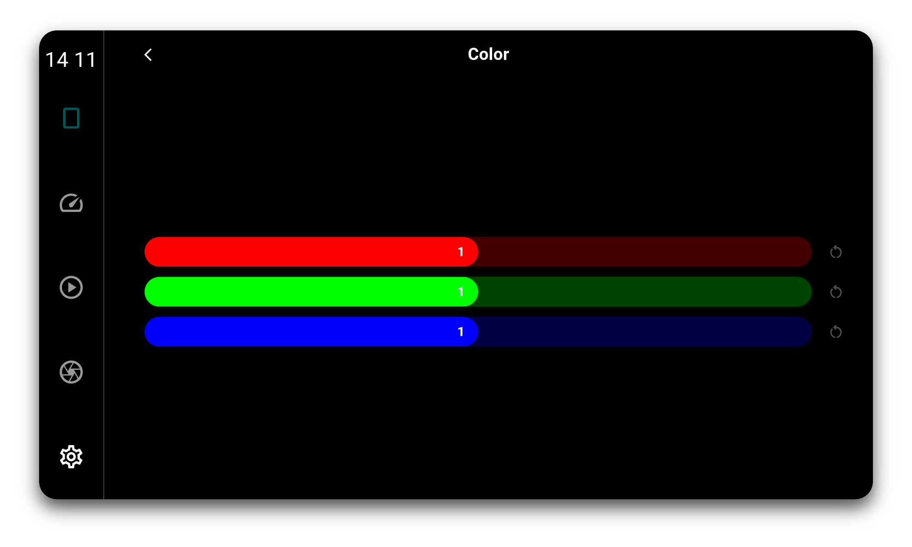
</p>

## Dashboard

The Dashboard is the car's instrument cluster. It comes in layouts, built the way a car maker's CarPlay theme is: each layout decides where the gauges, the speed and the warning lights sit and whether the phone's cluster stream runs behind them. With a car maker's theme on the phone, the palette picked there colours the gauges. Step through the layouts with the page dots, a swipe or the Cluster Layout key (default T). LIVI comes back with the layout and the palette picked last.

The dashboard is a WIP. While the IPC/socket telemetry payload already supports many signals, the UI exposes only a subset. Widgets and layouts will be extended over time.

### Pushing telemetry

LIVI's core binary pushes test data into a running LIVI. On macOS it sits in
`LIVI.app/Contents/Resources/core/livi-core`, on Linux the AppImage hands it over:
`./LIVI-<version>.AppImage telemetry set gear=R`. Every field and where it goes is listed in
`native/livi-helperd/crates/livi-core-proto/src/telemetry.rs`.

```bash
# Plausible values for every field at once
livi-core telemetry demo

# Single fields, a dot nests into a block
livi-core telemetry set fuelPct=4 rangeKm=38
livi-core telemetry set gps.lat=53.5912 gps.lng=10.015
livi-core telemetry set speedKph=90 rpm=2500 --every-ms 1000

# Light main screen, dark CarPlay cluster
livi-core telemetry set nightMode=false clusterNightMode=true

# LIVI's own UI
livi-core telemetry set darkMode=false nightMode=true

# A warning in the CarPlay cluster, it stays until Enter closes it
livi-core telemetry set notification.title=Frost notification.text="Icy roads" notification.symbol=snowflake notification.open=true

# Own picture from ~/.config/LIVI/carplay-images/example.png, from the next CarPlay start
livi-core telemetry set notification.title=LIVI notification.symbol=example notification.open=true

# Another LIVI, or without livi-core at hand
livi-core telemetry set gear=R --to livi.local:4000
curl -d '{"gear":"R"}' http://livi.local:4000/telemetry
```

<p align="center">
  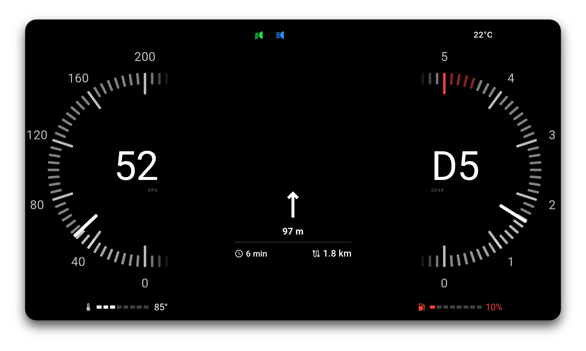
</p>

## Climate

LIVI describes the car's climate to CarPlay, and the phone draws the controls itself: both front
seat temperatures in the dock, the full panel on a tap, and the Climate app.

Every control works both ways. A change on the phone lands in the telemetry, a value pushed into
the telemetry reaches the phone. Like a car, synced zones let the passenger side follow the
driver, a manual fan level ends AUTO, and MAX A/C hands the previous settings back when it ends.
The last state is kept in `state/climate.json` and restored on start.

Covered: on/off, AUTO, A/C, MAX A/C, MAX defrost, recirculation, synced zones, temperature per
seat, fan level and fan AUTO, vents, front and rear window heating, and two-step seat heating.

```bash
livi-core telemetry set climate.driverTargetC=22 climate.fanLevel=3
livi-core telemetry set climate.driverSeatHeating=2
```

<p align="center">
  
  &emsp;
  
</p>

## GPS

LIVI reads a GNSS receiver on a serial port. The fix is published into the telemetry
store, from where the existing adapters carry it to CarPlay and Android Auto.

Any receiver speaking **NMEA-0183** works. On **u-blox** modules LIVI additionally polls
UBX for the module identity and the RF front end. Development and testing were done with
a **NEO-M9N**. Configuration (`config.json`):

| Key           | Default        | Description                                    |
| ------------- | -------------- | ---------------------------------------------- |
| `gpsEnabled`  | `false`        | Read the receiver                              |
| `gpsDevice`   | `/dev/ttyAMA0` | Serial device                                  |
| `gpsBaudRate` | `38400`        | NEO-M9N default; older modules use `9600`      |
| `timezone`    | `""`           | Last zone derived from a fix, applied at start |

The receiver also serves as a **time source**. Its satellite clock sets the system time, ahead of the time a phone offers at CarPlay session start, and the fix position selects the system timezone, so daylight saving follows the tz database instead of a manual switch.

Settings → General → GPS shows the live values under **GPS Data**, and the module identity together with antenna and interference state under **HW Info**. The same data is
mirrored to `state/gps.json` for external tools.

On a Raspberry Pi 5, `/dev/ttyAMA0` on GPIO 14/15 (PIN 8/10) does not exist until `dtoverlay=uart0` is set in `config.txt`.

<p align="center">
  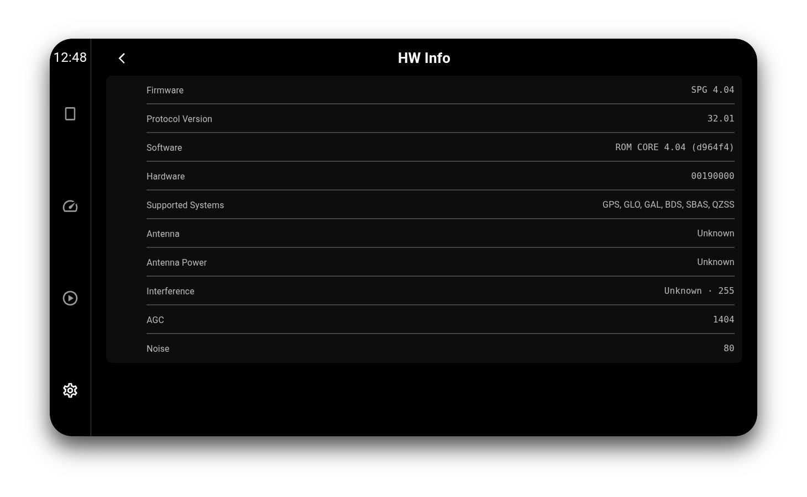
  &emsp;
  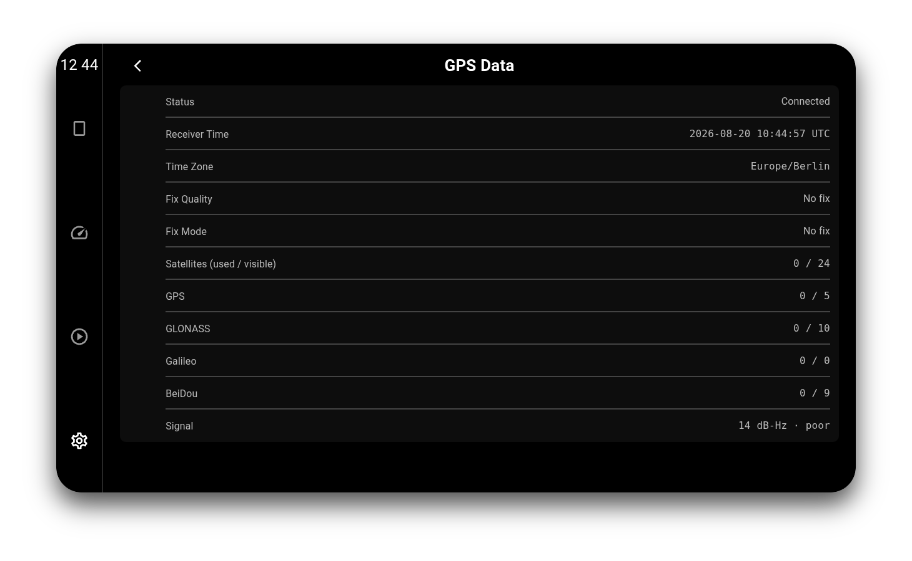
</p>

## DAB+

DAB+ radio via USB RTL-SDR (RTL2832U with R820T2).

- station scan, station list with logos, favourites and hidden stations
- radio text and station logos in LIVI's media player
- station order and hidden stations in Settings → DAB+

## Multi-Display

LIVI can run as multiple windows at once, each placeable on its own physical display.
The Dash and Aux windows are freely assignable and can show the Dashes, the reverse camera or the media player. Assignment is not exclusive: any feature can be shown on one, several, or all windows at the same time.

Configure each window under Settings → Window Settings
(Main Screen / Dash Screen / Aux Screen), and assign features under
Settings → General → Tab Settings.

<p align="center">
  
</p>

<p align="center">
  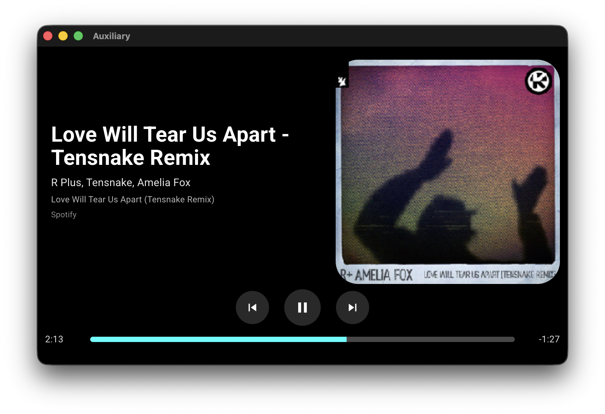
  
</p>

## View and Safe Area

Stream resolution, view area insets, and safe area can be configured independently for the main and cluster streams. This is supported for Android Auto as well as CarPlay.

### Main Stream

Video: 1280x720 - View Area: 0/0/100/0 (T/B/L/R) - Safe Area: 100/100/100/100 (T/B/L/R) - Draw Outside: true

<p align="center">
  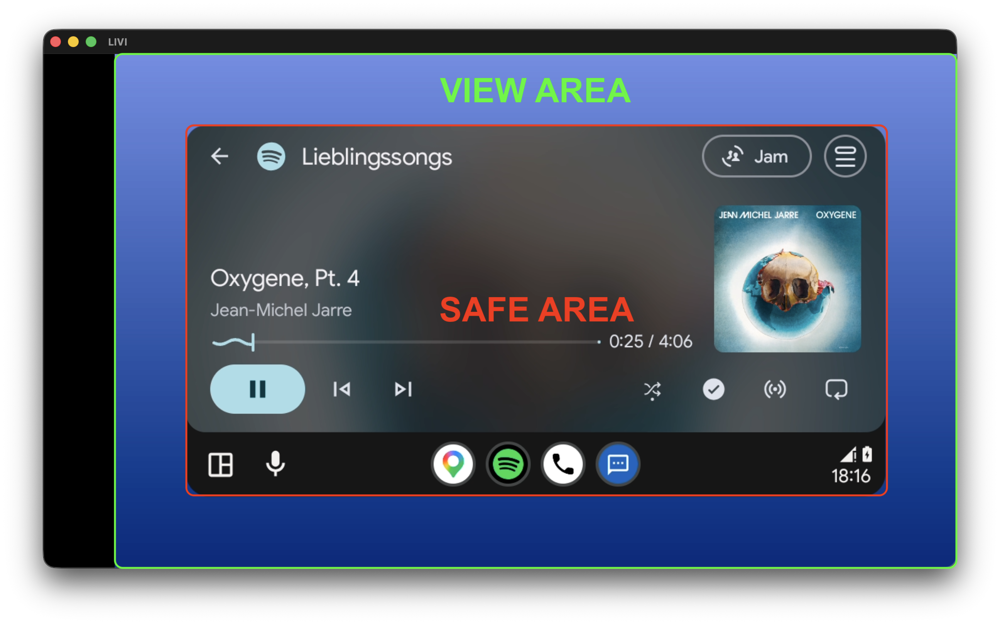
</p>

### Cluster Stream

Video: 1920x1080 - View Area: 0/0/0/0 (T/B/L/R) - Safe Area: 120/20/500/500 (T/B/L/R)

<p align="center">
  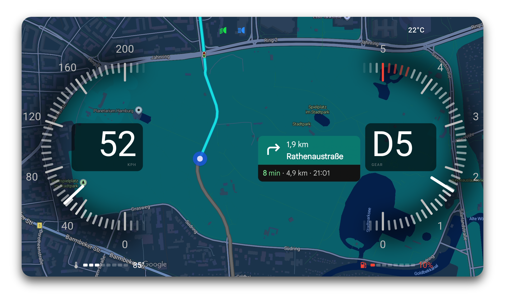
</p>

## Images

<p align="center">
  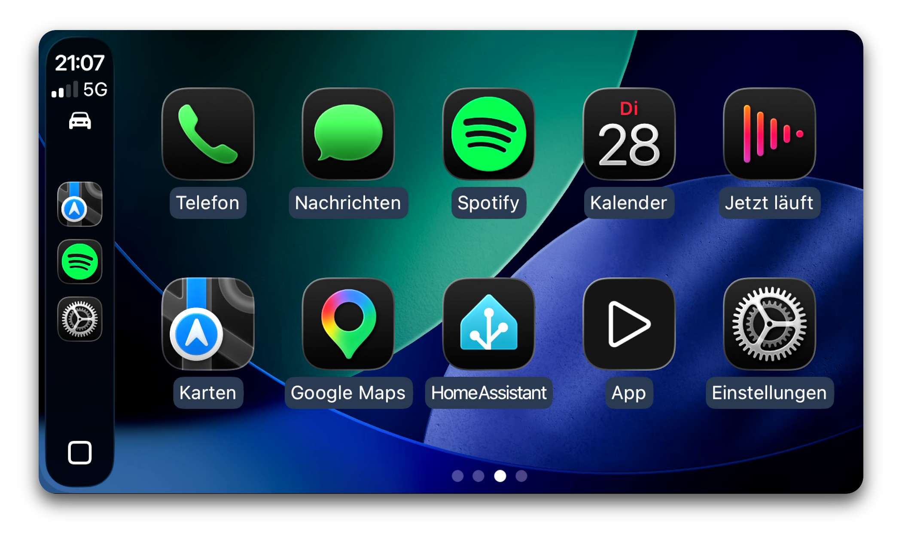
  &emsp;
  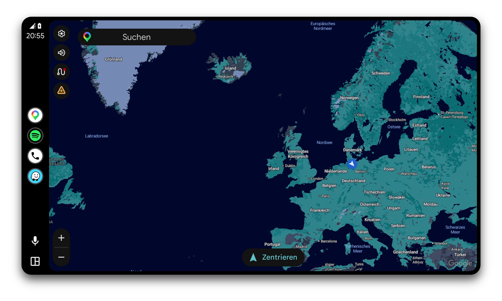
</p>

<p align="center">
  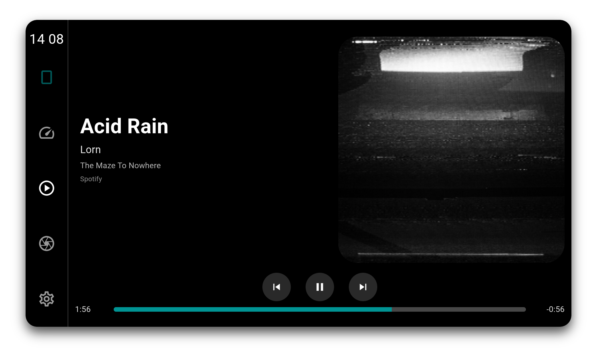
  &emsp;
  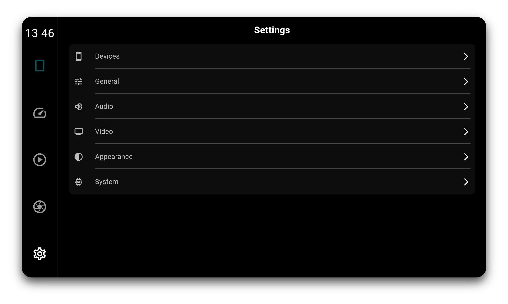
</p>

## Installation

One script installs LIVI on both desktop and headless hosts, auto-detecting which (override with `--desktop` / `--headless`). It uses apt, dnf or pacman, it runs on Debian/Ubuntu, Fedora, Arch and likely other distros, on arm64 and x86_64.

```bash
curl -fL -o install.sh https://raw.githubusercontent.com/f-io/LIVI/main/scripts/install/install.sh
chmod +x install.sh
./install.sh
```

_Tested on Raspberry Pi OS, Ubuntu 26.04 and Fedora 44._

> [!NOTE]
> The Pi Zero 2 W, Pi 3, Pi 4, CM 4, Pi 5 and CM 5 require Trixie (Debian 13).

## Linux (x86_64)

This AppImage has been tested on Debian Trixie (13) with Wayland, Fedora 44 (GNOME) and Ubuntu 26.04.

```bash
chmod +x LIVI-*-linux-x64.AppImage
```

> **Hardware video decode (optional):** LIVI uses the system VA-API driver for GPU video decode (it is not bundled, since it must match your GPU and kernel). Most desktops ship it, a minimal install may not. Without it LIVI still works via software decode. For HW decode install the driver for your GPU and verify with `vainfo`: `i965-va-driver` (older Intel, e.g. Broadwell), `intel-media-va-driver` (Gen9+ Intel), `mesa-va-drivers` (AMD).

## Mac (arm64)

Download the `-arm64.dmg`, open it, and drag **LIVI.app** into Applications.

When launching the app for the first time, macOS may block it.
In that case:

1. Try to open the app once (it will be blocked)
2. Go to **System Settings → Privacy & Security**
3. Scroll down and click **“Open Anyway”**
4. Confirm the dialog

After this, the app will launch normally and future updates will work without additional steps.

## Build Environment


### System Requirements (build)

Make sure the following packages and tools are installed on your system before building. The lists below cover both building and running, including everything native CarPlay needs:

- **Rust** (via [rustup](https://rustup.rs), which installs the version pinned in `rust-toolchain.toml`): builds everything, the UI included.
- **build-essential** (Linux: includes `gcc`, `g++`, `make`, etc.)
- **libgstreamer1.0-dev** + **libgstreamer-plugins-base1.0-dev** (required to build the `livi-gst-host` binary)
- **libssl-dev** (Linux only: native CarPlay links OpenSSL)
- **pkg-config**, **cmake** (AWS-LC build), **libwayland-dev** + **libxkbcommon-dev** (Linux only: the embedded Wayland compositor links both)
- **libfontconfig1-dev** (Linux only: the UI looks up fonts through fontconfig)
- **libudev-dev**, **libinput-dev**, **libseat-dev**, **libgbm-dev** (Linux only: the compositor drives the display directly)
- runtime packages for native CarPlay and wireless Android Auto: **bluez**, **libspa-0.2-bluetooth**, **hostapd**, **dnsmasq-base**, **iw**, **rfkill**, **avahi-daemon**, **avahi-utils**, **pulseaudio-utils**

On Debian/Ubuntu/Raspberry Pi OS, install everything with:

```bash
sudo apt-get update
sudo apt-get install -y git build-essential \
  pkg-config cmake libssl-dev \
  libgstreamer1.0-dev libgstreamer-plugins-base1.0-dev \
  libwayland-dev libxkbcommon-dev libfontconfig1-dev \
  libudev-dev libinput-dev libseat-dev libgbm-dev \
  fuse3 bluez libspa-0.2-bluetooth hostapd dnsmasq-base iw rfkill avahi-daemon avahi-utils \
  pulseaudio-utils
curl --proto '=https' --tlsv1.2 -sSf https://sh.rustup.rs | sh -s -- -y
```

The helper talks to the MFi coprocessor and the GPIO that powers it through the kernel's
i2c and gpio character devices, so no extra package is needed for either.

On Fedora, install everything with:

```bash
sudo dnf install -y git gcc gcc-c++ make \
  pkgconf-pkg-config systemd-devel cmake openssl-devel \
  gstreamer1-devel gstreamer1-plugins-base-devel \
  wayland-devel libxkbcommon-devel fontconfig-devel \
  libinput-devel libseat-devel mesa-libgbm-devel \
  fuse3 fuse3-libs \
  bluez hostapd dnsmasq iw avahi avahi-tools pulseaudio-utils
curl --proto '=https' --tlsv1.2 -sSf https://sh.rustup.rs | sh -s -- -y
```

Fedora has no `rfkill` package, the command comes with `util-linux`. `libspa-0.2-bluetooth` is a Debian name too: it holds PipeWire's Bluetooth plugin, which Fedora ships inside `pipewire-libs`. Wireless Android Auto needs that plugin because the phone will only start a session over an HFP connection, and PipeWire is what puts HFP into the adapter's service record. LIVI's package check probes for the plugin's directory rather than a package name, so it reports the gap on any distro. Everything else, including wireless CarPlay, works the same.

On macOS, building needs Rust and the GStreamer framework (runtime and devel pkg from gstreamer.freedesktop.org).

### Clone & Build

```bash
# Git clone
git clone --branch main --single-branch https://github.com/f-io/LIVI.git \
  && cd LIVI

cd native

# Linux
cargo xtask package-linux

# macOS
cargo xtask package-mac
cargo xtask package-mac --arch x64    # Intel on Apple Silicon

# Native binaries only
cargo xtask build-native
```

`package-linux` needs [appimagetool](https://github.com/AppImage/appimagetool) on the `PATH`, or its path in `APPIMAGETOOL`, and `desktop-file-validate` (package `desktop-file-utils`).

## Debugging

Diagnostic environment flags and where to find the logs are documented in [DEBUGGING.md](DEBUGGING.md).

## Credits

See [CREDITS](CREDITS.md) for acknowledgements and prior art.

## Disclaimer

_Apple and CarPlay are trademarks of Apple Inc. Android and Android Auto are trademarks of Google LLC. This project is not affiliated with or endorsed by Apple or Google. All product names, logos, and brands are the property of their respective owners._

## License

LIVI is free software, licensed under the **GNU General Public License v3.0 or later** (`GPL-3.0-or-later`). See [LICENSE](LICENSE) for the full text.

Copyright (C) 2025 Lasse Heitgres

You are free to use, study, share, and modify LIVI. If you distribute it or a modified version, you must pass on the same freedoms and make the corresponding source available under the GPL. It comes with NO WARRANTY, to the extent permitted by law.
