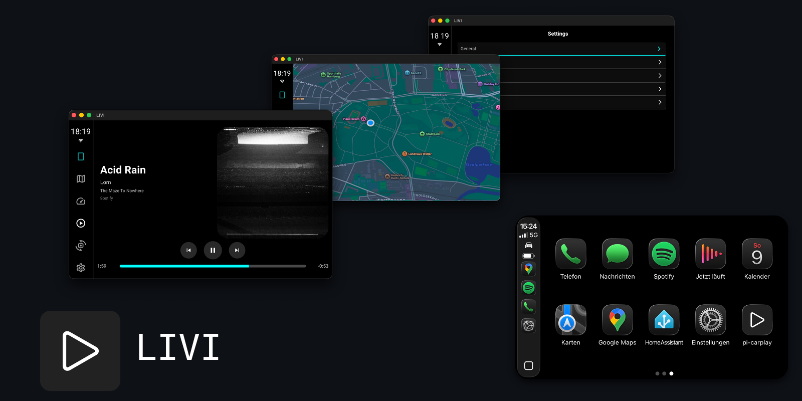
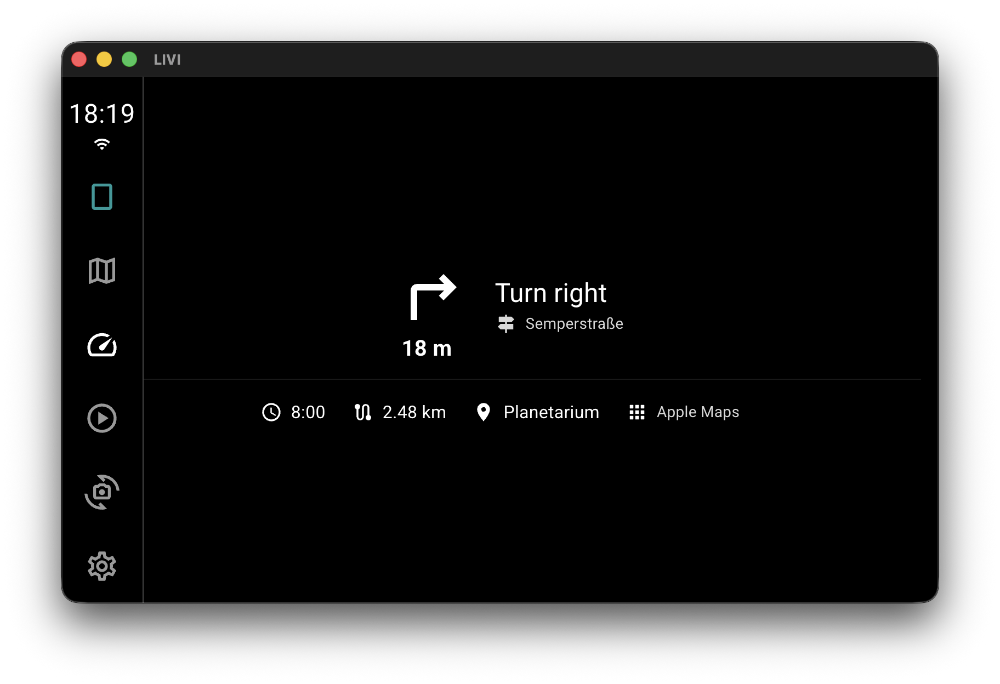
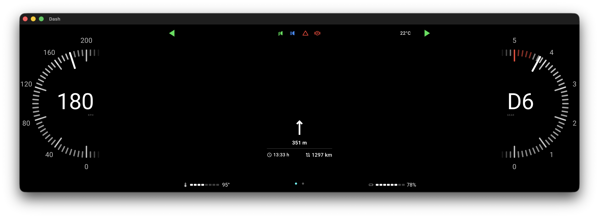
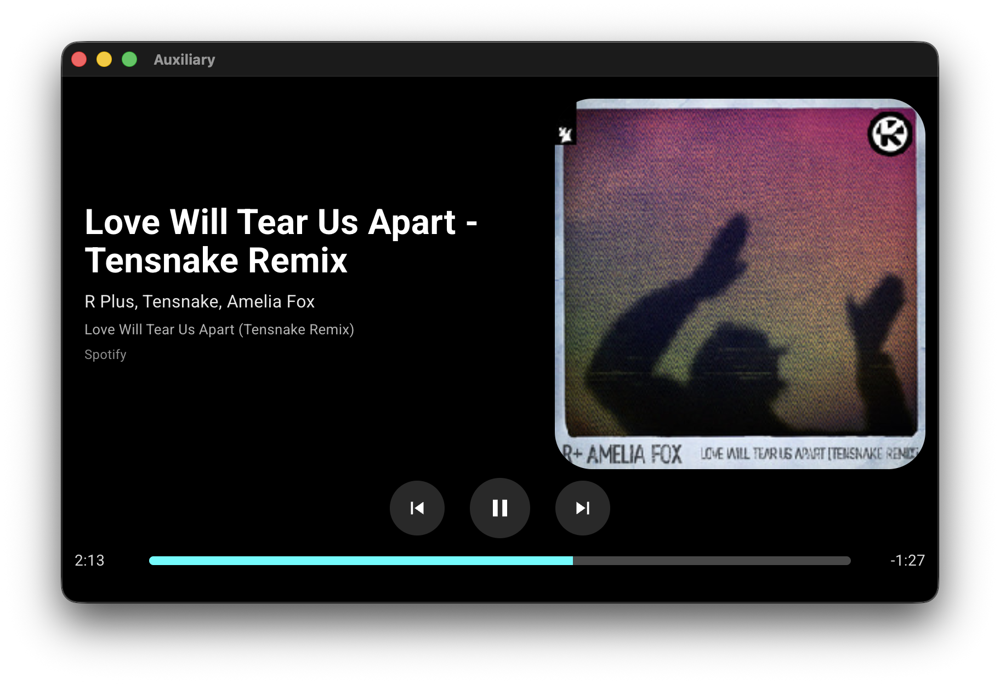
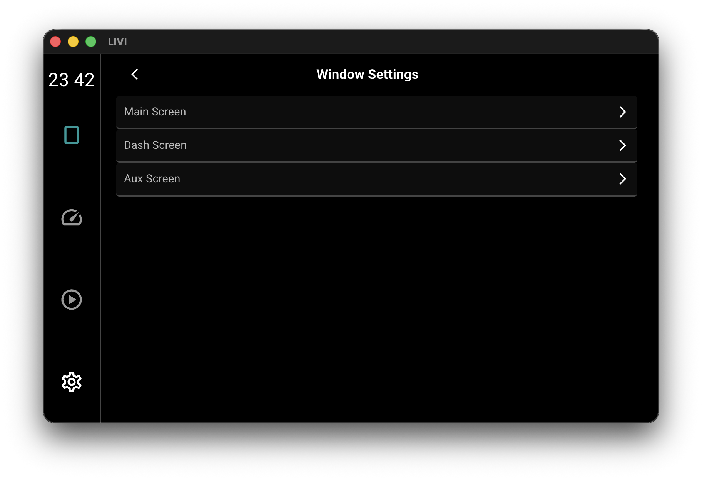
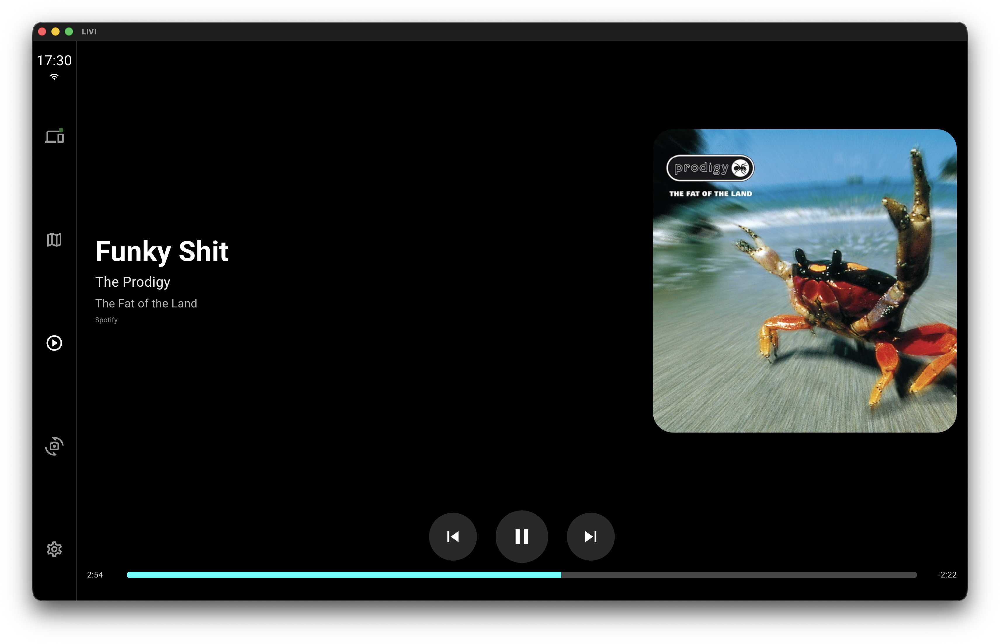
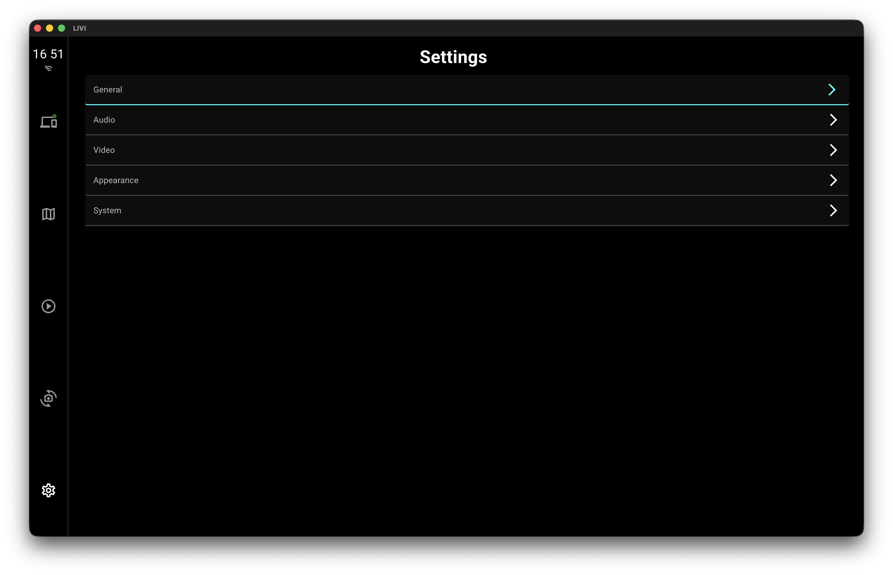

<p align="center">
  
</p>

# LIVI – Linux In-Vehicle Infotainment

LIVI is an open-source **Apple CarPlay and Android Auto head unit**.

It is a standalone cross-platform head unit with a native, zero-copy GStreamer video pipeline and hardware-accelerated decoding on Linux (including the Raspberry Pi 4 and 5) and macOS, low-latency audio, multitouch + D-Pad navigation, and support for very small embedded/OEM displays.


## Project Status


## Native Connectivity

- **Apple CarPlay** (wired & wireless) on Linux — requires [MFi Authentication](#mfi-authentication)
- **Android Auto** (wired) on all platforms
- **Android Auto** (wireless) on Linux

## Native Apple CarPlay

LIVI implements the CarPlay accessory side natively on Linux. Wireless sessions run over LIVI's own Wi-Fi access point with Bluetooth pairing, wired sessions run directly over the USB cable (no OTG required).

- main + instrument cluster video (H.264/H.265, hardware decoded, zero-copy)
- audio playback, phone calls, microphone uplink
- now-playing metadata incl. album art, turn-by-turn navigation data
- touch, knob/D-Pad and hard-key input
- day/night mode and GPS forwarding to the phone
- multi-session with live switching between connected phones

Wireless CarPlay requires a Bluetooth adapter and a Wi-Fi interface dedicated to the access point. Wired CarPlay works on any USB port.


## MFi Authentication

CarPlay requires the accessory to authenticate against the phone using an Apple **MFi authentication coprocessor**. This is a hardware chip, it cannot be emulated in software, and LIVI does not ship or bypass it. You need a physical coprocessor (e.g. salvaged from a certified CarPlay accessory or sourced as a module) wired to the I²C bus of your board.

LIVI talks to the chip directly. Configuration (`config.json`):

| Key                   | Default | Description                          |
| --------------------- | ------- | ------------------------------------ |
| `carPlayMfiI2cBus`    | `2`     | I²C bus number the coprocessor is on |
| `carPlayMfiPowerGpio` | `21`    | GPIO that powers the coprocessor     |

Without a coprocessor, native CarPlay is unavailable. Dongle-based CarPlay and all Android Auto paths work regardless.


## Wireless

Wireless sessions do not need a router. LIVI brings up its own Wi-Fi access point and the phone joins that. Bluetooth carries the pairing and the handover, the session itself then runs over Wi-Fi.

Wireless CarPlay and wireless Android Auto are enabled separately, so a head unit can offer one, both, or neither. With Auto Connect on, a phone that has been paired before is picked up again on its own. The car name is what the phone shows when it lists nearby vehicles.

The Wi-Fi page sets the band, password, channel and country for the access point, and picks which Wi-Fi and Bluetooth adapter to use.

Dedicated Interface reserves the Wi-Fi adapter for the access point and brings it up during boot, out of NetworkManager's hands. Without it the access point is started on demand and the interface is handed back afterwards, which keeps it available for normal networking but costs a moment on the first connection.

Configure under Settings → General → Connections.

<p align="center">
  
  &emsp;
  
</p>


## Multi-Session

Several phones can be connected at the same time. All of them are tracked live: every session keeps its state, its battery and signal readings, its media metadata and its turn-by-turn navigation up to date in the background, not just the one on screen.

Switching is a handover, not a reconnect. The drivers stay armed and the video and audio paths stay open, so bringing another phone forward takes milliseconds instead of multiple seconds.

Wireless CarPlay, wired CarPlay and wireless Android Auto each take several devices at once. Wired Android Auto is currently limited to one device. Everything within that limit can be combined freely, so a mixed set of CarPlay and Android Auto phones over cable and Wi-Fi is a normal case, not an exception.

Each device is shown with its transport, its battery level and its carrier or signal strength, and the numbered badge is the slot it occupies. The active session is highlighted, the others are marked as available.

Switch from the device list, or bind a key under Settings → General → Key Bindings → Cycle Session to step through the connected phones. Removing a device ends its session and forgets the pairing.

Manage under Settings → Devices.

<p align="center">
  
</p>


## Display Calibration

Car displays are rarely colour accurate. Cheap panels wash out blacks, run cold or warm, or crush the shadows once the sun hits them. LIVI can correct this in software.

Gamma, contrast, and the red, green and blue channels are adjustable independently. The correction is applied by the compositor as a single pass over the finished frame, so it covers everything on screen: the LIVI interface, the dashboards, and the projected CarPlay or Android Auto video alike.

The pass only runs while a value differs from its default, so a display that needs no correction costs nothing.

Configure under Settings → Appearance → Contrast / Gamma and Settings → Appearance → Color.

<p align="center">
  
  &emsp;
  
</p>


## Dashboard

The Dashboard is a WIP. While the IPC/socket telemetry payload already supports many signals, the UI exposes only a subset. Widgets and layouts will be extended over time.

For the Raspberry Pi 4 Haltech CAN V2 receiver and TJD CarPiHAT wiring,
configuration, and bring-up steps, see the
[Haltech CAN wiring and setup guide](https://github.com/DrSkunk/livi-os-buildroot/blob/main/docs/HALTECH-CAN.md).

### Telemetry CLI (local)

To push test data into a running LIVI, use the CLI in `scripts/tools`. The full
field list and routing lives in
`src/main/shared/types/Telemetry.ts`.

```bash
pnpm -C scripts/tools install

# Realistic all-fields demo push
pnpm -C scripts/tools run telemetry:demo

# Send single fields or blocks ad-hoc
pnpm -C scripts/tools run telemetry:set fuelPct=4 rangeKm=38
pnpm -C scripts/tools run telemetry:set gps.lat=53.5912 gps.lng=10.015
pnpm -C scripts/tools run telemetry:set _repeatMs=1000 speedKph=90 rpm=2500
```

<p align="center">
  
</p>


## Multi-Display

LIVI can run as multiple windows at once, each placeable on its own physical display.
The Dash and Aux windows are freely assignable and can show the Dashes, the reverse camera or the media player. Assignment is not exclusive: any feature can be shown on one, several, or all windows at the same time.

Configure each window under Settings → Window Settings
(Main Screen / Dash Screen / Aux Screen), and assign features under
Settings → General → Tab Settings.

<p align="center">
  
</p>

<p align="center">
  
  
</p>


## View and Safe Area

Stream resolution, view area insets, and safe area can be configured independently for the main and cluster streams. This is supported for Android Auto as well as CarPlay.

### Main Stream
Video: 1280x720 - View Area: 0/0/100/0 (T/B/L/R) - Safe Area: 100/100/100/100 (T/B/L/R) - Draw Outside: true
<p align="center">
  
</p>

### Cluster Stream
Video: 1920x1080 - View Area: 0/0/0/0 (T/B/L/R) - Safe Area: 120/20/500/500 (T/B/L/R)
<p align="center">
  
</p>


## Images

<p align="center">
  
  &emsp;
  
</p>

<p align="center">
  
  &emsp;
  
</p>


## RetroArch games

The Games page uses a horizontal library with cover art, game titles and system names. Select a game to launch it; import and controller-pairing controls remain in the page header. The library follows LIVI's light, dark and custom dashboard colors.

The Raspberry Pi installers create a game library at `~/Games/roms` and configure LIVI to use RetroArch's standard playlist and thumbnail directories:

- playlists: `~/.config/retroarch/playlists`
- thumbnails: `~/.config/retroarch/thumbnails`

Both installers—and LIVI's importer itself—create these compatible ROM folders:

```text
~/Games/roms/
├── doom/
├── gameboy/
├── gameboy-color/
├── gba/
├── nds/
├── nes/
├── snes/
├── genesis/
└── master-system/
```

Installers add **DOOM (Freedoom)**, a libre DOOM-compatible campaign, to the `doom` folder by default. Place legally obtained ROMs in the matching folder, then press **Games → Import ROMs**. LIVI detects DOOM WADs, GB, GBC, GBA, Nintendo DS, NES, SNES, Sega Genesis/Mega Drive and Sega Master System files; finds installed cores; writes RetroArch `.lpl` playlists; and downloads matching box art from the Libretro thumbnail repositories. Standard No-Intro/Redump filenames produce the best thumbnail matches. Multi-disc PlayStation folders containing an `.m3u` file are imported as one game. Paths can be changed under **Settings → General → Games**.

The Raspberry Pi installers also install the available `libretro-prboom`, `libretro-gambatte`, `libretro-mgba`, `libretro-desmume`, `libretro-nestopia`, `libretro-snes9x` and `libretro-genesisplusgx` packages. SNES and Genesis packages are in Debian's non-free component and are skipped with a warning when that component is unavailable.

Pair a Bluetooth gamepad without leaving LIVI: put the controller in pairing mode, open **Games → Pair controller**, press **Scan**, then **Pair** beside the controller. LIVI pairs, trusts, and connects it through BlueZ; RetroArch detects it as a normal Linux gamepad. Reboot once after a fresh installation so `input` and `bluetooth` group membership applies.

## MiniDSP

The MiniDSP page provides master volume and bass gain controls, with touch-sized step buttons and preset selection. The active preset is marked with a check. Controls follow LIVI's dashboard theme; connection status and refresh are shown in the header.


## Installation

> [!IMPORTANT]
> LIVI requires **OpenGL ES 3.x**.


## Raspberry Pi OS with Desktop

Use the standalone desktop installer on a fresh 64-bit Raspberry Pi OS with Desktop installation. It installs LIVI and all runtime dependencies, RetroArch, and the latest [minidsp-rs](https://github.com/mrene/minidsp-rs) Debian package. It enables `minidsp.service` immediately and at boot; LIVI connects to its HTTP API at `http://127.0.0.1:5380`.

> [!NOTE]
> The Pi 4, CM 4, Pi 5 and CM 5 require Trixie (Debian 13) for OpenGL ES 3.x. Pi 3 and earlier use the VideoCore IV GPU, which only supports OpenGL ES 2.0 and is therefore unsupported.

```bash
curl -fL -o install.sh https://raw.githubusercontent.com/DrSkunk/LIVI/main/scripts/install/desktop/install.sh
chmod +x install.sh
./install.sh
```

The default command downloads the latest arm64 AppImage from [DrSkunk/LIVI releases](https://github.com/DrSkunk/LIVI/releases). That repository must contain a published release with an `arm64.AppImage` asset. To install a local build or a direct AppImage URL instead:

```bash
./install.sh /path/to/LIVI-arm64.AppImage
# or
./install.sh https://example.com/LIVI-arm64.AppImage
```

Run it as the desktop user, not as root; the script invokes `sudo` when needed. It is safe to re-run. Reboot when it finishes so boot, I2C and autostart changes all take effect. LIVI starts automatically in the desktop session, RetroArch is available at `/usr/bin/retroarch`, and the MiniDSP daemon can be checked with:

```bash
systemctl status minidsp.service
```

_This installer targets Raspberry Pi OS with Desktop. It should also work on Debian or another apt-based desktop, but those distributions are not actively tested._


## Headless

For a fresh 64-bit Raspberry Pi OS Lite host with no desktop session. The installer sets up LIVI's kiosk environment and runtime dependencies, installs RetroArch, and installs the latest [minidsp-rs](https://github.com/mrene/minidsp-rs) Debian package with `minidsp.service` enabled immediately and at boot. It should also work on Debian or another apt-based headless Linux on arm64 or x86_64.

```bash
curl -fL -o install.sh https://raw.githubusercontent.com/DrSkunk/LIVI/main/scripts/install/headless/install.sh
chmod +x install.sh
./install.sh
```

Run it as the regular login user, not as root; the script invokes `sudo` when needed and is safe to re-run. Reboot when it finishes. LIVI then runs fullscreen on tty1 and logs to `~/LIVI/LIVI.log`. RetroArch is available at `/usr/bin/retroarch`, and LIVI connects to the MiniDSP daemon at `http://127.0.0.1:5380`. Check the daemon with `systemctl status minidsp.service`. Shutting LIVI down from its own menu ends the service and hands tty1 back to the login shell, so a reboot brings the kiosk back.


> [!NOTE]
> The script sets the boot target to `multi-user.target` so the kiosk owns the screen. On a host that boots into a desktop, that disables the graphical login. Undo it with `sudo systemctl set-default graphical.target`.


## Linux (x86_64)

This AppImage has been tested on Debian Trixie (13) with Wayland, Fedora 44 (GNOME) and Ubuntu 26.04.

```bash
chmod +x LIVI-*-x86_64.AppImage
```

> **Hardware video decode (optional):** LIVI uses the system VA-API driver for GPU video decode (it is not bundled, since it must match your GPU and kernel). Most desktops ship it, a minimal install may not. Without it LIVI still works via software decode. For HW decode install the driver for your GPU and verify with `vainfo`: `i965-va-driver` (older Intel, e.g. Broadwell), `intel-media-va-driver` (Gen9+ Intel), `mesa-va-drivers` (AMD).


## Mac (arm64)

Download the `-arm64.dmg`, open it, and drag **LIVI.app** into Applications.

When launching the app for the first time, macOS may block it.
In that case:

1. Try to open the app once (it will be blocked)
2. Go to **System Settings → Privacy & Security**
3. Scroll down and click **“Open Anyway”**
4. Confirm the dialog

After this, the app will launch normally and future updates will work without additional steps.


## Build Environment


### System Requirements (build)

Make sure the following packages and tools are installed on your system before building. The lists below cover both building and running, including everything native CarPlay needs:

- **Node.js 24.x** (with `corepack` for `pnpm`)
- **Python 3.x** (for native module builds via `node-gyp`)
- **build-essential** (Linux: includes `gcc`, `g++`, `make`, etc.)
- **libgstreamer1.0-dev** + **libgstreamer-plugins-base1.0-dev** (required to build the `gst-video` addon)
- **meson** (≥ 1.4), **ninja**, **pkg-config**, **bison**, **cmake** and the wlroots/EGL stack: **libwayland-dev**, **wayland-protocols**, **libxkbcommon-dev** (≥ 1.8.0), **libpixman-1-dev**, **libcairo2-dev**, **libegl-dev** / **libgles-dev** / **libgbm-dev** / **libffi-dev** / **libexpat1-dev** (Linux only: to build the embedded wlroots compositor)
- **fuse3** (required to run AppImages)
- runtime packages for native CarPlay and wireless Android Auto: **bluez**, **libspa-0.2-bluetooth**, **hostapd**, **dnsmasq-base**, **iw**, **rfkill**, **avahi-daemon**, **avahi-utils**, **pulseaudio-utils**, **python3-dbus**, **python3-gi**, **python3-smbus2**, and **pymobiledevice3** from pip for wired CarPlay

On Debian/Ubuntu/Raspberry Pi OS, install everything with:

```bash
sudo apt-get update
sudo apt-get install -y git build-essential python3 python3-dev python3-pip \
  pkg-config bison ninja-build cmake \
  libgstreamer1.0-dev libgstreamer-plugins-base1.0-dev \
  libegl-dev libgles-dev libgbm-dev libffi-dev libexpat1-dev \
  libwayland-dev wayland-protocols libxkbcommon-dev libpixman-1-dev libcairo2-dev \
  fuse3 bluez libspa-0.2-bluetooth hostapd dnsmasq-base iw rfkill avahi-daemon avahi-utils \
  pulseaudio-utils python3-dbus python3-gi python3-smbus2
pip3 install --user --break-system-packages 'meson>=1.4' pymobiledevice3
curl -fsSL https://deb.nodesource.com/setup_24.x | sudo -E bash -
sudo apt-get install -y nodejs
sudo corepack enable
```

On a Raspberry Pi, the MFi coprocessor is powered from a GPIO, which needs one more package:

```bash
sudo apt-get install -y python3-lgpio python3-rpi-lgpio
```

Raspberry Pi OS ships both already, a plain Debian on a Pi does not.

On Fedora, install everything with:

```bash
sudo dnf install -y git gcc gcc-c++ make python3 python3-devel \
  pkgconf-pkg-config systemd-devel \
  gstreamer1-devel gstreamer1-plugins-base-devel \
  meson ninja-build bison cmake \
  wlroots-devel wayland-devel wayland-protocols-devel libxkbcommon-devel \
  pixman-devel cairo-devel \
  mesa-libEGL-devel mesa-libGLES-devel mesa-libgbm-devel libffi-devel expat-devel \
  fuse3 fuse3-libs \
  bluez hostapd dnsmasq iw avahi avahi-tools pulseaudio-utils \
  python3-dbus python3-gobject
pip3 install --user pymobiledevice3 smbus2
curl -fsSL https://rpm.nodesource.com/setup_24.x | sudo bash -
sudo dnf install -y nodejs
sudo corepack enable
```

Fedora has no `rfkill` package, the command comes with `util-linux`, and `python3-smbus2` does not exist there either, so `smbus2` comes from pip above. `libspa-0.2-bluetooth` is a Debian name too: it holds PipeWire's Bluetooth plugin, which Fedora ships inside `pipewire-libs`. Wireless Android Auto needs that plugin because the phone will only start a session over an HFP connection, and PipeWire is what puts HFP into the adapter's service record. LIVI's package check probes for the plugin's directory rather than a package name, so it reports the gap on any distro. Everything else, including wireless CarPlay, works the same.

On macOS, the `gst-video` addon links against the **GStreamer.framework**. Install
both the runtime and development packages (matching versions) from
[gstreamer.freedesktop.org](https://gstreamer.freedesktop.org/download/#macos)
before building. `node-gyp` discovers it via `pkg-config` under
`/Library/Frameworks/GStreamer.framework`.

### Clone & Build

```bash
# Git clone
git clone --branch main --single-branch https://github.com/DrSkunk/LIVI.git \
  && cd LIVI

# Install dependencies from lockfile
pnpm run install:ci

# --- Build targets ---

# Linux (AppImage)
pnpm run build:linux:arm64         # ARM
pnpm run build:linux:x64           # X86_64

# macOS (dmg)
pnpm run build:mac:arm64           # Apple Silicon
pnpm run build:mac:x64             # Intel
```

Linux AppImages include `resources/livi-os-helper-api` to declare the launcher
contract used by the immutable LIVI OS integration. Keep the marker and the
`LIVI_OS=1` helper launch path in sync with the OS image's fixed privileged
helper interface.


## Debugging

Diagnostic environment flags and where to find the logs are documented in [DEBUGGING.md](DEBUGGING.md).


## Credits

See [CREDITS](CREDITS.md) for acknowledgements and prior art.


## Disclaimer

_Apple and CarPlay are trademarks of Apple Inc. Android and Android Auto are trademarks of Google LLC. This project is not affiliated with or endorsed by Apple or Google. All product names, logos, and brands are the property of their respective owners._


## License

LIVI is free software, licensed under the **GNU General Public License v3.0 or later** (`GPL-3.0-or-later`). See [LICENSE](LICENSE) for the full text.

Copyright (C) 2025 Lasse Heitgres

You are free to use, study, share, and modify LIVI. If you distribute it or a modified version, you must pass on the same freedoms and make the corresponding source available under the GPL. It comes with NO WARRANTY, to the extent permitted by law.
